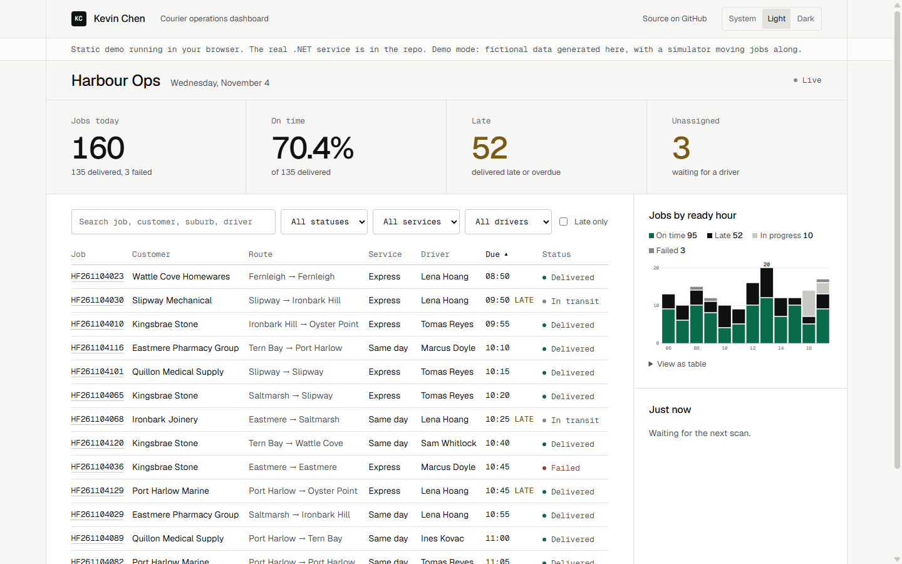

# Courier operations dashboard

One screen for today's jobs: KPI tiles, a searchable jobs table, job details, a chart and live updates when a job changes. It belongs to Harbour Freight Couriers, a fictional courier company, and all data is generated.



*The static demo build: KPIs, the jobs table and jobs by ready hour, on fictional data. Screenshot taken in a headless browser on 4 November 2026.*

Built with React 19, TypeScript and Vite, on an ASP.NET Core (.NET 10) API with SQLite and SignalR.

## The problem

An operations manager usually pieces the day together from a dispatch system, spreadsheets and phone calls. By the time a late job is noticed, the customer has already rung. They want to open one page and see how many jobs are on today, how many are late, which have no driver, and to have those numbers move as things happen.

## What it does

- **KPI tiles:** jobs today, on-time percentage, late and unassigned. Clicking Late or Unassigned filters the table to those jobs.
- **Jobs table:** search, status, service, driver and late filters, with sorting and paging all done by the server, so it stays fast on a large table.
- **Job detail drawer:** freight, driver, vehicle and a timeline of every status change.
- **Chart:** jobs by ready hour, stacked by on time, late, in progress and failed, with hover and keyboard tooltips and a table view.
- **Live updates:** SignalR pushes each job change. The tiles, table and chart refresh, the changed row flashes, and a feed lists the latest scans. A simulator stands in for drivers' scanners.
- **Login:** cookie sign-in with one demo user. Every data route and the live hub answer 401 without it.
- **Demo mode:** a static build with the whole backend replaced by generated data in the browser, for hosting on GitHub Pages.

Definitions, so nobody has to guess: a job is **late** if it was delivered after its due time, or is unfinished and past its due time. A delivery exactly on the due time is on time. A failed job counts as failed, not late. **On time** is the share of delivered jobs that were not late, and it shows no figure until something has been delivered, rather than a misleading 0%.

## Architecture

```
React 19 + Vite
   |  DataSource interface
   |-- apiSource: fetch + SignalR ----> ASP.NET Core API
   |                                      |-- cookie auth
   |                                      |-- OpsQueries (filter, sort, page in SQL)
   |                                      |-- OpsHub (SignalR) <-- JobSimulator
   |                                      |-- EF Core --> SQLite, seeded by a generator
   |
   \-- demoSource: generated rows + simulator in the browser (GitHub Pages build)
```

The late rule exists on both sides, because demo mode has no server. `tests-shared/kpi-fixture.json` holds a set of boundary cases with the expected answers, and both test suites read it, so the two cannot quietly drift apart.

## Test results

Latest run, from a fresh clone on Windows 11, .NET SDK 10.0.108, Node 22: **72 tests, 72 passed, 0 failed, 0 skipped**, with `dotnet build` at 0 warnings and 0 errors. `tsc` and both production builds are clean, and `npm audit` found 0 vulnerabilities.

| Suite | Tests | What is covered |
|---|--:|---|
| API (xUnit) | 41 | KPIs against the shared fixture, chart totals, paging with no repeats or gaps, sorting, unknown sort column refused, filters, search with SQL characters, login and logout, cookie flags, 401 on every data route, a real SignalR client receiving a change, anonymous hub refused |
| Front end (Vitest) | 31 | The same fixture, client-side query logic, tiles, chart, login, drawer, filters, live changes in the demo source |

To check the tests can fail, I changed the late rule from "after due" to "at or after due" on both sides, and restored it. That failed 3 API tests and 2 front-end tests.

The tests also found a real bug during the build: jobs booked for later today had a "Booked" event in the future. It is fixed on both sides and has a test.

The running stack was also exercised over HTTP: anonymous requests got 401, login worked, the hub negotiated, and the unassigned count went from 37 to 36 between two reads as the simulator ran. The demo build was served under `/courier-ops-dashboard/` and returned its page, with its assets at that base path.

The chart uses greys with one accent for jobs delivered on time, taken from theme tokens so each theme has its own values. Each series also has a legend entry with its total, and the table view gives the numbers without any colour.

## How to run

You need the .NET 10 SDK and Node 22.

```bash
# Tests
dotnet test Harbour.Ops.slnx
cd web && npm ci && npm test && cd ..

# The whole app on one port: build the front end into the API, then run it
cd web && npm run build && cd ..
dotnet run --project api/Harbour.Ops.Api --urls http://localhost:5183
```

Open `http://localhost:5183` and sign in with `ops@harbourfreight.example` and `harbour-demo`. The database is created next to the build output and seeded with 160 jobs for today.

For front-end work, run the API as above and `npm run dev` in `web/`, which proxies the API to port 5173.

### Demo mode

```bash
cd web
npm run build:demo      # writes web/dist-demo, base path /courier-ops-dashboard/
npm run preview:demo    # serves it at http://localhost:4173/courier-ops-dashboard/
```

Live demo: [https://kevindemo.github.io/courier-ops-dashboard/](https://kevindemo.github.io/courier-ops-dashboard/). The look changed after the last deployment, so `dist-demo` needs publishing again to show it.

### Hosting the real service

The static demo needs no server. To host the real .NET service as well, the repo has a multi-stage `Dockerfile` (.NET 10, listens on `$PORT`) and a `render.yaml` blueprint for Render's free web service plan. SQLite is created on start and seeded with today's jobs by the API's own generator, and the image builds the front end into the API's `wwwroot`. The image itself has not been built, because Docker was not available on the machine where this was written. `dotnet publish` was run instead and the published build answered over HTTP with the same settings.

## What a client gets

A dashboard on your own data, with the scope agreed in writing first:

1. The numbers your managers actually use, with written definitions agreed up front, because "late" always turns out to have exceptions.
2. A read-only connection to your existing system, so the dashboard needs no change to how dispatch works. Live updates come from your events or from polling, whichever your system can do.
3. Login through your existing identity provider, with roles.
4. Tests on the numbers, so a later change cannot quietly alter what the business is measuring.

Details and contact: [kevindemo.github.io](https://kevindemo.github.io).

## Honest limitations

- The UI was checked with screenshots in a headless browser (see `docs/`), not with automated end-to-end browser tests.
- The live push reaching a real browser is not tested. A .NET SignalR client over long polling is, and the React side is tested against the demo source.
- It is view-only. A manager can see an unassigned job here but must assign it elsewhere.
- Generated data and a simulator. 160 jobs a day is small, so there is no performance claim here. KPIs load all of today's jobs into memory, which would need changing at much higher volumes.
- One demo user with a password in `appsettings.json`, no rate limit on login, and no HTTPS setup. It is a demo sign-in flow, not a production one.
- SQLite with `EnsureCreated`, with no migrations. A real deployment would use your database, and production SignalR across several servers needs a backplane.
- Times are shown in the browser's time zone, while "today" and the chart hours use the depot's zone (`Ops:TimeZone`). A viewer in another zone would see them differ.
- Demo mode restarts its data on each page load.
